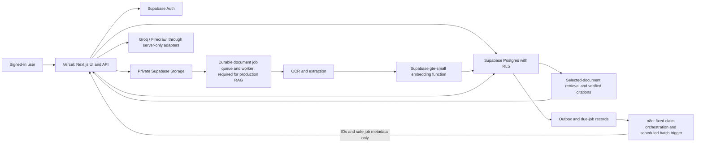

# ProductVault production-readiness assessment and plan

**Reviewed:** 28 October 2026  
**Branch snapshot:** `main` at `d3361a0`, matching `origin/main`; working tree was clean.  
**Scope:** Strengthen existing ProductVault features and its product-owned data flow. This plan does not add new product features.

## Executive assessment

The current main branch is a feature-rich MVP codebase, not a production-ready service yet. The app has real Next.js API routes, Supabase-backed ownership flows, OCR/vector/RAG code, a claim processor, a cross-store price engine, reminder APIs, and two saved n8n workflows. Code presence is not proof that the deployed environment, live schema, external credentials, or full user journeys work together.

The clearest release blockers are:

1. The local status documents disagree about which RAG migrations and functions are live. The RAG status note reports SQL Editor changes on `bankai`; the app README and ADR describe parts of the same path as unapplied or unconnected. Reconcile the live schema and migration history before running any migration command.
2. RAG indexing is synchronous in a Next.js request. There is an owner-scoped processing-job API and a worker design, but no connected durable queue consumer/publication worker. A client disconnect or a slow document can interrupt processing.
3. Both n8n workflows are inactive. The claim workflow has an inbound Header Auth credential, but its app-processing HTTP node has no credential assigned. The reminder workflow calls a placeholder URL and has no scheduler credential configured.
4. The reminders/notifications/price-check migration is in `main` but project documentation says it has not been applied or database-validated. The optional Postmark setup is absent.
5. The price engine and Firecrawl configuration exist locally, but no production retailer observation or scheduled price-check run has been verified.
6. The user is currently sharing a local app through ngrok. That is suitable for a demo or webhook test while the PC and tunnel are running; it is not the production hosting and availability layer.

## What exists in `main`

| Feature | Present in the main codebase | What is not yet proven production-ready |
| --- | --- | --- |
| Sign-in and account | Supabase SSR sessions, Google sign-in, email sign-in, “keep me signed in on this device,” cookie choices, profile/avatar settings, sign-out | Production redirect URLs and email delivery must be checked on the final domain. Google working on the current test URL does not validate every deployed callback. |
| Product passport | Manual, invoice-assisted, and product-link entry; product create/read/update/delete APIs; product-specific views and timeline | Validate every flow with the live schema and more than one signed-in account. Amazon import UI has a manual fallback; the n8n import URL/workflow is not configured in the local environment. |
| Private product documents | Product-linked invoice, warranty, and manual uploads use the private Supabase Storage bucket and owner-scoped document APIs | Verify live Storage policies, size limits, signed-download behavior, deletion cleanup, and cross-user denial. |
| Document indexing and RAG | The current index route extracts PDF text, uses local OCR fallback for pages/images, calls `embed-text`, writes 384-dimensional `gte-small` vectors, and marks document status. The assistant route checks the owner, selected product and indexed document IDs, performs vector search, and validates citation IDs before returning citations. | Indexing is still request-bound. The processing-job endpoint does not itself start a worker. The live schema/function claims in the docs conflict, and signed-in upload → indexed → cited-answer plus cross-user tests remain unverified. There is no general-purpose non-vault chat mode in the current assistant. |
| Claim preparation | Claim intake API, private file references, idempotent event/outbox design, protected app-side processor, Groq review, source-quote validation, editable draft approval record; no automatic external submission | The outbox migration, n8n callback credential, current public app URL, and full synthetic round trip need verification. The n8n workflow is inactive. |
| Price watch and comparison | Manual watch support; price analysis and cross-store adapter code for Amazon India, Flipkart, Croma, and Meesho; Firecrawl client/configuration; validation meant to reject ambiguous or unverified offers | No successful production check is recorded. A local Firecrawl key only shows configuration, not permission, quota, cost, retailer compliance, or reliable current prices. Daily automation is not live. |
| Reminders and inbox | Five code-level reminder types (warranty/policy expiry, service, replenishment, claim follow-up, price watch), reminder APIs, notification inbox, read state, email preference API, protected daily batch endpoint | The additive migration is not confirmed in `bankai`; scheduler workflow is inactive; no matching reminders secret is configured locally; Postmark is absent. No customer email should be sent yet. |
| n8n workflows | `ProductVault App API` and `ProductVault Reminders & Price Checks` exist in the connected n8n account | Both are inactive. See the live n8n inspection below. |
| Stable navigation | Dashboard views have distinct `/dashboard/...` routes and browser navigation is handled in the app | Recheck deep-link, refresh, sign-in redirect and back/forward behavior on the deployed domain. |

Other planned ideas such as B2B workspaces, company-level sharing, and pre-purchase policy Q&A across public retailer/insurer sources are not current production features. They are outside this hardening plan unless you separately confirm they are already-approved scope. The rule for this pass is to improve the existing consumer product and its strongest claim/document/price/reminder flows.

## Actual n8n state inspected

Read-only inspection of the connected n8n account found:

- **ProductVault App API** (`VhmDra9QWmtcokXe`) is inactive. It has a `POST productvault/intake` Webhook with Header Auth and an assigned credential, followed by a 202 acknowledgement and a call to the app's `/api/integrations/n8n/process` endpoint. The HTTP node has no assigned authentication credential, so it cannot currently authenticate to the protected app processor. Its URL points at the current ngrok host.
- **ProductVault Reminders & Price Checks** (`uMswrAFgMBmy9aII`) is inactive. It has a daily 9:00 schedule configured for Asia/Kolkata, but the app URL is still a placeholder and no authentication credential is assigned. It sends `batchSize: 100`, which must be load-tested and likely reduced or replaced by queued batches before production use.
- Both workflow settings currently avoid saving successful and manual execution data. Preserve that privacy posture; error payloads must also avoid document text, user contact details, and secrets.
- No separate Amazon-import workflow appeared in the ProductVault workflow search. The UI/API should continue to provide the manual fallback until that import path is explicitly configured and verified.

## Recommended architecture

Supabase remains the source of truth for users, products, private files, claims, reminders, price observations, and notification state. Next.js handles signed-in product actions and enforces authorization. n8n is only for fixed workflows and schedules; it should not proxy ordinary reads/writes, the chatbot, embeddings, or document contents. This keeps app latency and privacy predictable and lets the system handle retries with durable state.

## End-to-end implementation plan

### Phase 0 — Reconcile the actual baseline

1. Keep `main` as the release source and create a staging environment/project separate from `bankai` production.
2. Reconcile `docs/rag-live-integration.md`, `apps/web/README.md`, `docs/adr/0001-document-grounded-rag.md`, `docs/n8n-integration.md`, and the latest PRD. They currently disagree about the live RAG schema, vector writes, OCR, and migration status.
3. In Supabase Dashboard, inspect live tables, extensions, policies, functions, Storage bucket policies, and `supabase_migrations.schema_migrations`. Compare them with every SQL file in `supabase/migrations`.
4. Because earlier migrations were applied through SQL Editor, do not run a bulk `supabase db push` until migration history has been reconciled. Preserve production data; only use additive, reviewed migrations.
5. Take a backup appropriate to the project plan and test a restore path before changing production schema.

**Exit gate:** one checked-in migration ledger says which migration is applied where; no live migration is applied twice or guessed from stale docs.

### Phase 1 — Lock deployment and auth configuration

1. Deploy the Next.js app from `main` to Vercel (or another real application host) with a stable ProductVault domain. Add the domain and environment variables to Vercel's Production environment, not only the local `.env.local`.
2. Set `APP_BASE_URL` to that final HTTPS origin. In Supabase Auth URL Configuration, set the Site URL to the production origin and allow the production `/auth/callback` route plus localhost/ngrok redirect URLs only for development. Keep the Google OAuth provider callback pointed at Supabase's `/auth/v1/callback` URL.
3. Verify Google and email sign-in, sign-out, cookie/session lifetime, expired links, and deep-link return after refresh on both production and development URLs. Configure a production SMTP provider for Supabase Auth if the default email service is not appropriate for launch volume; this is separate from ProductVault reminder email.
4. Add only server-side secrets in Vercel. Keep the Supabase publishable key public; keep `SUPABASE_SECRET_KEY`, Groq, Firecrawl, n8n shared secrets, and Postmark tokens out of browser variables and logs.

**Exit gate:** a user can sign in and reach only their own workspace on the final host; callback URLs match the final domain; no secret appears in client bundles.

### Phase 2 — Prove tenancy and database safety

1. Review grants and RLS on products, documents, claims/evidence/approvals, chunks/jobs, reminders, notifications/preferences/deliveries, price watches/observations, and any outbox tables.
2. Treat service-role access as privileged because it bypasses RLS. For each route using it, authenticate first, verify the target belongs to the signed-in user, and pass only validated IDs into a narrow database operation.
3. Run real two-account tests: account A cannot list, read, edit, delete, download, search, or infer account B's rows/files; account A cannot retrieve its own unselected documents through RAG.
4. Review database functions for explicit grants, safe `search_path`, owner checks, bounded results, and atomic state changes. Inspect indexes and query plans for owner-filtered lists, due reminder scans, vector search, and job claims.
5. Apply and verify the reminders/price-watch migration only after the baseline check. Verify the cross-store price migration as well; the fact that a SQL file exists in `main` does not mean it is in `bankai`.

**Exit gate:** database-backed isolation tests pass; all tables have intentional grants/RLS; migration state is reproducible and reversible.

### Phase 3 — Make document indexing durable

1. Keep direct browser upload to private Supabase Storage; never route large document bytes through n8n or oversized Vercel request bodies.
2. Connect the existing document job table to a durable Supabase Queue and a real worker. The worker must lease jobs, retry safely, enforce page/byte/time limits, and write safe error codes.
3. Run native-text extraction and approved OCR in the worker runtime, not in an ordinary user request. Confirm the OCR binary/model, memory, and execution-region behavior in the actual deployment runtime before choosing the worker host.
4. Use the existing `gte-small` embedding contract consistently for document and question vectors. Enforce the 512-token model limit. Store provenance per page/section and distinguish incomplete extraction from ready-to-search.
5. Write a new index generation separately and switch the active version atomically only after every page/chunk/vector succeeds. On failed re-index, keep the last successful generation searchable.
6. Keep the assistant retrieval owner-, product-, and selected-document-scoped. Validate citation IDs against retrieved rows. Test supported, conditional, conflicting, and insufficient-evidence answers with synthetic invoice/policy files.

**Exit gate:** signed-in synthetic upload → OCR/extraction → vector storage → cited answer works on the deployed staging stack; retry/re-index tests pass; cross-user and unselected-document tests pass.

### Phase 4 — Finish the claim workflow through n8n

1. Reconcile and apply the claim outbox migration in the verified database environment.
2. In the n8n `ProductVault App API` workflow, keep the inbound Header Auth credential and assign a separate templated Header Auth credential to the `/api/integrations/n8n/process` HTTP node. Its header must match the server's `N8N_CALLBACK_SECRET`; do not reuse the app-to-n8n webhook secret.
3. Replace the ngrok URL with the Vercel staging URL for staging tests. Keep ngrok for local testing only.
4. Use synthetic events to verify unauthorized calls fail, duplicate IDs do not create duplicate claims, n8n retries are safe, the user sees processing/failure/review states, and the final draft's citations refer to the same owner's private documents.
5. Keep every external claim message behind the existing explicit user approval. This flow prepares a draft; it does not submit claims automatically.
6. Minimize n8n payloads and retain no success/manual data. Error data must not include OCR/policy text or email/phone details.

**Exit gate:** the webhook and protected callback complete a synthetic round trip against staging, with safe retries, no private content in n8n data, and workflow still inactive until explicitly approved for production.

### Phase 5 — Finish reminders and notifications

1. Apply and verify `20261028110000_reminders_notifications_and_price_checks.sql` after migration reconciliation.
2. Set a new random `N8N_REMINDERS_SECRET` in Vercel and create a matching n8n credential using `x-productvault-scheduler-secret`. The current local file does not contain this variable.
3. Replace the reminder workflow's placeholder URL with the staging `/api/integrations/n8n/reminders` URL and assign the credential. Start with small bounded batches; do not assume 100 jobs fit one function call.
4. Test the five reminder types, automatic 30/7-day expiry reminders, edit/snooze/complete/cancel, duplicate dispatch, notification read state, timezone and user opt-out.
5. Keep in-app alerts available independently. If email is in scope, verify a Postmark sender/domain, set the token only in Vercel, and test with an owned test mailbox. Do not send real customer email during verification.

**Exit gate:** a scheduled dry run creates exactly one expected inbox item per event, respects opt-outs, handles retries, and reports aggregate counts only to n8n.

### Phase 6 — Harden price tracking and cross-store comparison

1. Verify the four adapter paths one at a time with fixtures and permitted test listings. Confirm retailer terms and Firecrawl usage/cost for each source before automated requests.
2. Require the retailer, product variant, currency, price, availability, source, and checked-at time to validate. Missing or ambiguous prices must display “Price unavailable,” never ₹0 or “verified.” Keep manual price history separate from automated observations.
3. Add per-user and per-retailer request caps, bounded timeouts, response limits, cache policy for public catalogue responses only, stale-result labels, and a safe manual fallback.
4. Only turn on daily checks after the migration, secret, workflow, batch limits, and synthetic retry tests pass. Do not let a failed scrape overwrite a verified historical observation.

**Exit gate:** a staged scheduled run produces validated observations for known fixtures, rejects ambiguous/mismatched variants, never emits zero as a verified price, and stays within provider/retailer quotas.

### Phase 7 — Load, security, operations, and release

1. Define the launch target first: expected monthly active users, peak concurrent users, daily document pages, peak price checks, and monthly spend ceiling for Supabase, Vercel, Groq, Firecrawl, n8n, OCR, and optional email.
2. Load-test realistic mixed traffic on staging. Measure API latency/error rate, DB connection/pool pressure, vector-search latency, queue depth/oldest job age, n8n concurrency, Firecrawl/Groq rate limits, and cost per completed workflow.
3. Add rate limits and per-user quotas to expensive operations: invoice extraction, OCR/indexing, chatbot answers, price checks, claim processing, and retries. Auth/Data API protection alone does not cover all Next.js routes or external providers.
4. Use private/no-store responses for personal data. Cache only safe public/static data; never shared-cache account, claim, document, notification, or answer responses.
5. Align the Vercel function region with the Supabase project region where possible; use the Supabase pooler if adding direct Postgres connections for workers. Keep function work bounded and move slow processing to the durable worker.
6. Turn on production alerts and review logs without payloads/secrets. Set spend alerts and a rollback procedure. Verify database backups and separately plan recovery for Storage objects.
7. Release in stages: preview → staging synthetic end-to-end → small private beta → production. Activate n8n workflows only after all exit gates pass; monitor first executions, then raise batch sizes based on measured headroom.

**Exit gate:** security review, cross-user tests, restore rehearsal, measured load test, provider budget limits, monitoring and rollback are documented and passed for a stated launch target.

## Manual actions you need to complete

1. **Choose hosting for public use:** deploy `main` to Vercel and connect a stable domain. Continue to use ngrok for demos/local webhook tests, not as the production origin.
2. **Set production environment values in Vercel:** use the variable names in `apps/web/.env.example`; copy values directly from their providers, never into chat. At minimum this includes Supabase URL/publishable key/secret key, `APP_BASE_URL`, Groq settings, Firecrawl key, and the claim n8n URL/token/callback secret. Add `N8N_REMINDERS_SECRET` only when configuring that workflow. Postmark values are optional until you choose email reminders.
3. **Supabase Dashboard:** verify project `bankai`, inspect live schema and RLS, reconcile migration history, then apply only reviewed missing additive migrations. Update Auth Site URL/redirect allow-list for the production domain and development URLs. Keep Google's OAuth callback pointing at Supabase's callback.
4. **n8n:** assign the callback credential to the existing claim processor node; configure the reminders endpoint URL and matching scheduler credential; verify execution retention remains minimized. Keep both workflows inactive while testing.
5. **Email:** if enabling reminder emails, verify a Postmark sender domain and set the token/from address only as server-side Vercel variables. If using Supabase's email sign-in at launch volume, configure an appropriate custom Auth SMTP provider separately.
6. **Price checks:** confirm acceptable provider spend and that the planned retailer requests comply with each source's terms. A Firecrawl key in local `.env.local` does not mean the service is enabled in Vercel.
7. **Capacity target:** give the team an initial expected traffic profile and monthly cost ceiling so the load test and batch sizes have concrete pass/fail thresholds.

## ngrok: correct use for this project

The checked-in n8n claim node currently points to `https://regress-outer-ambiance.ngrok-free.dev`. For local tests, keep Next.js running on port 3000 and keep the ngrok agent connected to port 3000. A stable ngrok dev domain can keep the hostname fixed, but an agent endpoint only serves while its local agent and upstream app are running. The free ngrok plan also has request and bandwidth limits. Therefore the URL is a temporary integration target, not a scalable production host.

When deploying, change the app base URL and both n8n workflow destinations to the Vercel staging/production domain as appropriate; update Supabase's allowed redirects. Do not point production n8n or production Auth callbacks at a developer laptop.

## Verification status of this review

- Read-only inspection of local `main`, project documentation, route/component/migration file names, the ignored local environment **variable names only**, and n8n workflow configuration.
- No environment values or secrets were printed.
- No Supabase live schema query, migration, workflow mutation/activation, provider call, deployment, load test, or customer email was performed.
- The document establishes what to verify next; it does not certify the deployed system as production-ready.

## Primary references

- [Supabase production checklist](https://supabase.com/docs/guides/deployment/going-into-prod)
- [Supabase Row Level Security](https://supabase.com/docs/guides/database/postgres/row-level-security)
- [Supabase RAG with permissions](https://supabase.com/docs/guides/ai/rag-with-permissions)
- [Supabase Queues quickstart](https://supabase.com/docs/guides/queues/quickstart)
- [Supabase connection pooling and limits](https://supabase.com/docs/guides/database/connecting-to-postgres/pooling-and-limits)
- [Supabase backups](https://supabase.com/docs/guides/platform/backups)
- [Supabase Auth redirect URLs](https://supabase.com/docs/guides/auth/redirect-urls)
- [Vercel Functions limits](https://vercel.com/docs/functions/limitations)
- [Vercel production checklist](https://vercel.com/docs/production-checklist)
- [n8n webhook URLs and activation](https://docs.n8n.io/integrations/builtin/core-nodes/n8n-nodes-base.webhook/)
- [n8n Cloud concurrency](https://docs.n8n.io/deploy/use-n8n-cloud/understand-concurrency)
- [n8n execution-data retention](https://docs.n8n.io/deploy/host-n8n/configure-n8n/scaling/manage-execution-data/)
- [ngrok static development domains](https://ngrok.com/blog/free-static-domains-ngrok-users)
- [ngrok local sharing and tunnels](https://ngrok.com/use-cases/share-localhost)
