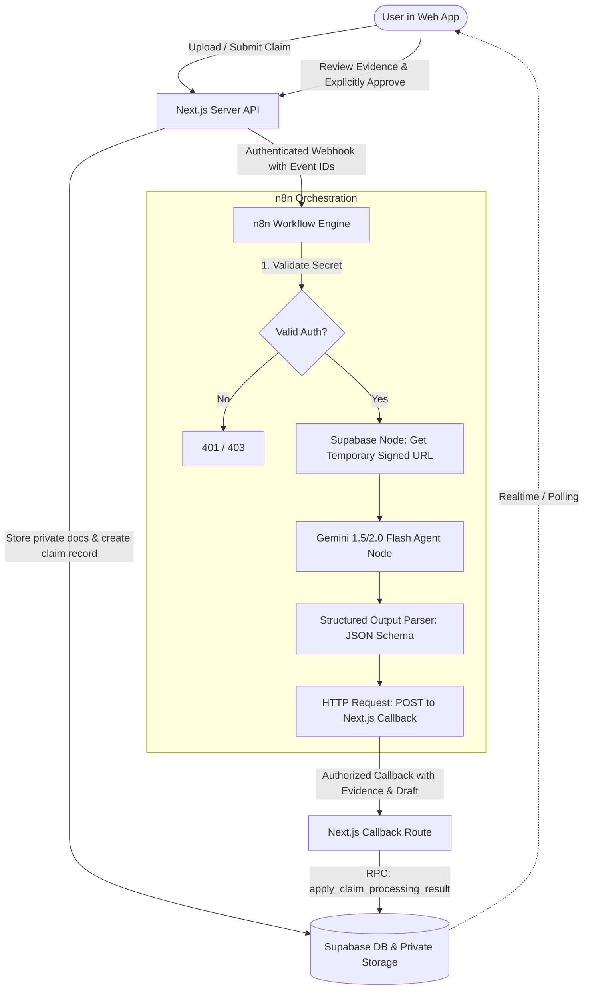

# ProductVault / ClaimForge: Google Gemini + n8n Deep Integration & Webhook Architecture Plan

**Document:** Comprehensive Research & Implementation Plan  
**Target Architecture:** Next.js (App & Auth Boundary) + Supabase (Postgres RLS, Storage) + n8n (Automation & Orchestration) + Google Gemini (Multimodal AI & Structured Reasoning)  
**Status:** Architecture Specification & Research Report (No code changes applied)  
**Author:** Antigravity Engineering  
**Date:** October 2026  

---

## 1. Executive Summary & Core Philosophy

This document outlines the end-to-end strategy for integrating **Google Gemini** into **n8n** to automate ClaimForge / ProductVault's core capabilities.

### Why Google Gemini + n8n?
1. **Direct Multimodal Processing without OCR pipelines:** Older architectures require Tesseract or AWS Textract to convert scanned invoices and warranty booklets into text before feeding them to an LLM. Gemini 1.5/2.0 Flash natively accepts raw PDF and image byte streams, analyzing formatted receipts, rubber stamps, folded serial numbers, and small-print warranty clauses directly with high fidelity.
2. **Massive Context Window (1M+ Tokens):** Extended warranties, insurance terms, and appliance user manuals can run 30–80 pages. Gemini effortlessly swallows entire policy manuals without needing complex, brittle chunking on initial intake.
3. **Native Structured Output & Tool Calling in n8n:** n8n's **Advanced AI** suite features a dedicated **Google Gemini Chat Model** node paired with the **Structured Output Parser**, enabling deterministic, strictly-typed JSON outputs matching ClaimForge’s internal database schemas.
4. **Clean Separation of Concerns (AGENTS.md & PRD.md Compliance):**
   - **Next.js:** Handles browser interactions, user authentication, session security, and deterministic validation.
   - **Supabase:** Serves as the single source of truth for products, claims, private documents, and RLS-protected records.
   - **n8n:** Acts as the background event orchestrator (retries, timeouts, waiting states, external API dispatches).
   - **Gemini:** Performs interpretation, evidence extraction, and draft synthesis.
   - **The Human Gate:** External claims, emails, or disputes are **never** dispatched automatically; they require explicit, recorded user approval in the web UI.



---

## 2. Gemini Integration Mechanisms in n8n

n8n offers two primary integration methods for Google Gemini:

### Method A: Native n8n Advanced AI Nodes (Recommended for Agents)
- **Node Stack:** `AI Agent` + `Google Gemini Chat Model` + `Structured Output Parser` + `Tools`.
- **Credentials:** Google AI Studio API Key (or Google Vertex AI service account).
- **Configuration:**
  - **Model:** `gemini-1.5-flash` (for fast, low-cost extraction) or `gemini-1.5-pro` (for complex policy clause disambiguation).
  - **Temperature:** `0.0` or `0.1` (crucial for deterministic fact extraction).
  - **Structured Output Parser:** Connected directly to the `AI Agent` node, injecting JSON schema instructions and parsing returning strings into structured n8n items.

### Method B: Native n8n HTTP Request Node to Gemini REST API (Direct & Lightweight)
- For high-volume binary file ingestion, you can call Google's REST API endpoint:
  `POST https://generativelanguage.googleapis.com/v1beta/models/gemini-1.5-flash:generateContent?key={{$credentials.apiKey}}`
- **Headers:** `Content-Type: application/json`
- **Body:**
  ```json
  {
    "contents": [
      {
        "role": "user",
        "parts": [
          { "text": "Extract all warranty terms and invoice dates." },
          {
            "inline_data": {
              "mime_type": "image/jpeg",
              "data": "={{ $binary.data.toBase64() }}"
            }
          }
        ]
      }
    ],
    "generationConfig": {
      "response_mime_type": "application/json",
      "temperature": 0.1
    }
  }
  ```
- **Advantage:** Native Google `response_mime_type: "application/json"` guarantees valid JSON parsing without prompt leakage.

---

## 3. Where in ClaimForge to Inject n8n + Gemini

The following table maps every high-value seam in the application to its corresponding n8n workflow, trigger, and user UX impact:

| Feature Seam | Trigger in App | n8n Role | Gemini Role | User UX Impact |
| :--- | :--- | :--- | :--- | :--- |
| **1. Claim Intake & Evidence Review** | User files claim at `/claims/new` | Receives webhook, downloads files via short-lived signed URLs, calls Gemini, posts callback to Next.js. | Analyzes invoice vs warranty terms, evaluates fault validity, outputs citations & claim draft. | User sees claim shift from "Received" to "Ready for Review" in ~5–10s with pre-cited evidence. |
| **2. Smart Document Ingestion & Autofill** | User uploads invoice on `/products/[id]` | Listens to doc upload event, triggers async analysis, saves extracted metadata to database. | Extracts purchase date, product name, model number, serial no, and warranty duration from raw invoice. | Zero manual typing: uploading a receipt instantly populates warranty expiry and product details. |
| **3. Proactive Reminders & Expiry Alerts** | n8n Cron (`Schedule Trigger`, 09:00 UTC) | Scans `reminders` table in Supabase via REST node, finds reminders due today, dispatches notifications. | Drafts customized notification message (e.g., "Your Sony WH-1000XM4 warranty expires in 14 days!"). | Timely in-app alerts and optional email notifications before warranty deadlines lapse. |
| **4. Automated Price Watch Engine** | n8n Cron (Every 6 or 12 hours) | Iterates active `price_watches`, fetches live product HTML/API, parses price, checks threshold. | Extracts current price and currency from complex e-commerce HTML when selectors break. | Instant alerts when tracked products hit the user's desired purchase or replenishment price. |
| **5. Pre-Purchase Policy Comparison** | User uploads 2 PDFs in Pre-Purchase tool | Orchestrates parallel document evaluation and returns side-by-side comparison JSON. | Highlights differences in exclusions, deductibles, waiting periods, and replacement clauses. | Transparent comparison table showing hidden warranty traps before user buys extended coverage. |
| **6. Dispute & Rejection Counter-Assistant** | User clicks "Claim Rejected by Brand" | Receives rejection letter/email text, gathers historical claim context, posts suggested rebuttal. | Identifies manufacturer evasion, cites Consumer Protection Act provisions, drafts formal appeal. | High-conviction appeal letter ready to copy or send with one click. |

---

## 4. Comprehensive Webhook Contracts & Data Schemas

### Seam 1: Claim Intake (Next.js -> n8n Webhook)
When a user submits a claim on `/claims/new`, Next.js creates the claim row in Supabase and immediately dispatches an authenticated background webhook to n8n.

#### Next.js Outgoing Request
- **Method:** `POST`
- **Target URL:** `https://your-n8n-instance.cloud/webhook/claim-intake`
- **Headers:**
  ```http
  Content-Type: application/json
  x-claimforge-secret: <N8N_WEBHOOK_AUTH_TOKEN>
  User-Agent: ClaimForge-Intake-Dispatcher/1.0
  ```
- **Payload Schema:**
  ```json
  {
    "$schema": "http://json-schema.org/draft-07/schema#",
    "type": "object",
    "properties": {
      "eventId": { "type": "string", "format": "uuid" },
      "eventType": { "type": "string", "const": "claim.intake.received" },
      "claimId": { "type": "string", "format": "uuid" },
      "productId": { "type": "string", "format": "uuid" },
      "userId": { "type": "string", "format": "uuid" },
      "timestamp": { "type": "string", "format": "date-time" },
      "claimData": {
        "type": "object",
        "properties": {
          "productName": { "type": "string" },
          "faultDescription": { "type": "string" },
          "failureDate": { "type": ["string", "null"] }
        },
        "required": ["productName", "faultDescription"]
      },
      "documents": {
        "type": "array",
        "items": {
          "type": "object",
          "properties": {
            "documentId": { "type": "string", "format": "uuid" },
            "kind": { "type": "string", "enum": ["invoice", "warranty_card", "other"] },
            "fileName": { "type": "string" },
            "storagePath": { "type": "string" },
            "mimeType": { "type": "string" },
            "sizeBytes": { "type": "integer" }
          },
          "required": ["documentId", "kind", "storagePath", "mimeType"]
        }
      }
    },
    "required": ["eventId", "eventType", "claimId", "productId", "claimData", "documents"]
  }
  ```

#### Immediate n8n Webhook Response (Synchronous Ack)
- **Status:** `202 Accepted`
- **Body:**
  ```json
  {
    "acknowledged": true,
    "eventId": "123e4567-e89b-12d3-a456-426614174000",
    "status": "queued_for_processing"
  }
  ```

---

### Seam 2: Claim Callback (n8n -> Next.js Callback Route)
Once n8n and Gemini finish extracting facts, checking terms, and generating the draft, n8n invokes ClaimForge's verified callback route (`/api/integrations/n8n/callback`).

#### Incoming Request from n8n to Next.js
- **Method:** `POST`
- **URL:** `https://claimforge.app/api/integrations/n8n/callback`
- **Headers:**
  ```http
  Content-Type: application/json
  x-claimforge-callback-secret: <N8N_CALLBACK_SECRET>
  ```
- **Payload Contract (Matches `callback/route.ts` specifications):**
  ```json
  {
    "claimId": "9b1deb4d-3b7d-4bad-9bdd-2b0d7b3dcb6d",
    "eventId": "a1b2c3d4-e5f6-4a5b-8c9d-0e1f2a3b4c5d",
    "status": "ready_for_review",
    "assessment": "likely within stated term",
    "claimDraft": "Dear Customer Support,\n\nI am writing to formally request warranty service for my Sony WH-1000XM4 headphones, purchased on January 15, 2026. The left earbud stopped outputting sound on October 12, 2026. This issue arose during normal usage and constitutes a manufacturing defect covered under Section 3 of the 1-Year Limited Warranty.\n\nPlease find attached the purchase invoice and warranty documentation. Kindly advise on the nearest authorized service center or return procedure.\n\nSincerely,\nProduct Owner",
    "evidence": [
      {
        "kind": "fact",
        "content": "Invoice dated 2026-01-15 confirms purchase from authorized retailer.",
        "sourcePage": 1,
        "confidence": 0.98,
        "documentId": "4a72d3f1-0a6e-4f3b-8255-0d24b6910e5e"
      },
      {
        "kind": "warranty_clause",
        "content": "Section 3.1: Manufacturer provides 12 months comprehensive hardware warranty against component failure.",
        "sourcePage": 2,
        "confidence": 0.95,
        "documentId": "8b92c4f2-1b7f-4f4c-9366-1e35c7021f6f"
      },
      {
        "kind": "inference",
        "content": "Failure date (2026-10-12) occurred approximately 9 months into the 12-month coverage window.",
        "sourcePage": null,
        "confidence": 0.99,
        "documentId": null
      }
    ]
  }
  ```

#### Validation Invariants Enforced by Next.js Callback:
1. `x-claimforge-callback-secret` must match `process.env.N8N_CALLBACK_SECRET` via timing-safe string comparison.
2. `claimId` and `eventId` must be valid UUID v4 format.
3. `status` must be one of: `"processing" | "needs_information" | "ready_for_review" | "needs_human_help"`.
4. `assessment` must be one of: `"likely within stated term" | "unclear" | "appears outside stated term"`.
5. `evidence.kind` must be one of: `"fact" | "warranty_clause" | "missing_item" | "inference"`.
6. `evidence` array capped at 12 items, each content string capped at 4000 characters without control characters.
7. Calls Supabase RPC `apply_claim_processing_result` with deterministic idempotency lock (`claimId:eventId`).

---

### Seam 3: Document Ingestion & Metadata Autofill (Next.js -> n8n)
When a user uploads a receipt or policy document in `/products/[id]`, n8n extracts structured product metadata.

#### Webhook Payload (Next.js -> n8n)
```json
{
  "eventId": "f47ac10b-58cc-4372-a567-0e02b2c3d479",
  "eventType": "document.uploaded",
  "productId": "e2a1b4c3-d5e6-4f7a-8b9c-0d1e2f3a4b5c",
  "documentId": "c3d4e5f6-a7b8-4c9d-0e1f-2a3b4c5d6e7f",
  "storagePath": "user_id_123/products/prod_456/invoice.pdf",
  "mimeType": "application/pdf"
}
```

#### Gemini Output Schema (Enforced via Structured Output Parser in n8n)
```json
{
  "type": "object",
  "properties": {
    "merchant": { "type": "string" },
    "purchaseDate": { "type": "string", "description": "YYYY-MM-DD format" },
    "totalAmount": { "type": "number" },
    "currency": { "type": "string" },
    "modelNumber": { "type": "string" },
    "serialNumber": { "type": "string" },
    "warrantyPeriodMonths": { "type": "integer" },
    "supportEmail": { "type": "string" },
    "supportPhone": { "type": "string" },
    "extractionConfidence": { "type": "number", "minimum": 0, "maximum": 1 }
  },
  "required": ["merchant", "purchaseDate", "warrantyPeriodMonths", "extractionConfidence"]
}
```

---

### Seam 4: Scheduled Reminders & Lifecycle Alerts (n8n -> Messaging & App)
An n8n workflow runs daily at 09:00 UTC via a `Schedule Trigger`.

#### Workflow Steps:
1. **Query Supabase:** Calls Supabase REST API `GET /rest/v1/reminders?due_date=lte.today&status=eq.scheduled`.
2. **Filter & Group:** Group by `user_id`.
3. **Gemini Copywriting (Optional):** Generates friendly, urgent in-app microcopy.
4. **Dispatch:**
   - Calls transactional email service (e.g., Resend / Sendgrid / Postmark).
   - If WhatsApp enabled, dispatches template message via Twilio / Gupshup.
5. **Update Supabase:** `PATCH /rest/v1/reminders?id=eq.{id}` setting `status = 'sent'`, `sent_at = NOW()`.

---

## 5. Detailed n8n Node-by-Node Canvas Configuration

### Workflow Canvas: "ProductVault Claim Intake & Gemini Evidence Assessor"

```
[1. Webhook: POST /webhook/claim-intake]
          │
          ▼
[2. Code Node: Authenticate Header Secret]
          │
          ├── (Unauthorized) ──► [3. Respond to Webhook: 401 Unauthorized]
          │
          └── (Authorized)   ──► [4. Respond to Webhook: 202 Accepted]
                                           │
                                           ▼
[5. Supabase Node: Create Signed URLs for Documents (Expire in 15 mins)]
                                           │
                                           ▼
[6. HTTP Request: Download Document Binaries (PDF / Image)]
                                           │
                                           ▼
[7. AI Agent / Google Gemini Chat Model]
   ├── Credentials: Google AI Studio API Key
   ├── Model: gemini-1.5-flash
   ├── System Prompt: "You are ProductVault's Senior Claims Adjudicator..."
   └── Connected: [8. Structured Output Parser (JSON Schema)]
                                           │
                                           ▼
[9. Code Node: Sanitize, Validate & Format Payload for App Callback]
                                           │
                                           ▼
[10. HTTP Request: POST to /api/integrations/n8n/callback]
   ├── Header: x-claimforge-callback-secret: {{$env.N8N_CALLBACK_SECRET}}
   └── Retry On Fail: 3 Attempts (Exponential Backoff)
```

### System Prompt for Gemini Inside the n8n Agent Node
```text
You are ProductVault's conservative, document-grounded claims adjudicator.
Your job is to analyze the user's reported fault against the uploaded invoice and warranty documentation.

RULES:
1. Rely ONLY on the provided invoice and warranty documents. Never invent warranty terms.
2. Classify assessment into one of:
   - "likely within stated term" (Purchase date + warranty duration covers failure date, fault appears non-excluded)
   - "unclear" (Missing invoice date, unreadable clause, or ambiguous fault description)
   - "appears outside stated term" (Warranty expired or damage explicitly excluded like liquid ingress/physical drop)
3. Return citations with exact source page numbers where readable.
4. Draft a respectful, professional claim letter addressed to the manufacturer/seller.
5. Never provide legal guarantees or legal advice.
```

---

## 6. Security, Privacy & Data Minimization (Crucial PRD Requirements)

1. **Timing-Safe Secrets:**
   All webhooks between Next.js and n8n utilize constant-time string matching (`crypto.timingSafeEqual`) to prevent timing attacks.
2. **Zero Permanent Storage of Documents in n8n:**
   Invoices, receipts, and warranty cards stay in Supabase private Storage (`claim-documents`). n8n receives only temporary, signed download URLs that expire within 10–15 minutes.
3. **Execution Data Minimization in n8n:**
   In `n8n` configuration, set:
   - `EXECUTIONS_DATA_SAVE_ON_SUCCESS=none` (or `all` with binary data pruning).
   - `EXECUTIONS_DATA_PRUNE=true`.
   - `EXECUTIONS_DATA_MAX_AGE=72` (hours).
   This ensures that personal invoices, PII, and customer addresses are not retained in n8n’s internal SQLite/Postgres database.
4. **Deterministic Gate before External Communication:**
   n8n **never** sends an email directly to a manufacturer or warranty service provider. The draft returned by n8n is stored as `claim_draft` in Supabase. The user must explicitly view the draft in the Next.js UI and click an "Approve & Send" / "Copy Draft" button.

---

## 7. Phased Implementation Roadmap

### Phase 1: Activate Claim Intake & Verification Seam (Immediate Priority)
- [ ] Configure n8n webhook URL (`N8N_CLAIM_INTAKE_WEBHOOK_URL`) and authorization token in Next.js `.env.local`.
- [ ] Set up the basic n8n workflow with the Webhook node, Gemini Chat Model node, and Next.js Callback node.
- [ ] Run synthetic end-to-end smoke tests using mock claim data to verify that `apply_claim_processing_result` updates claim status from `received` to `ready_for_review`.

### Phase 2: Document Indexing & Autofill using Gemini Multimodal
- [ ] Implement the `document.uploaded` webhook trigger in Next.js `/api/products/[id]/documents`.
- [ ] Build the n8n extraction flow to autofill purchase date, warranty months, and merchant details in `product_documents`.
- [ ] Implement error fallback (`needs_review`) when documents are blurry or corrupted.

### Phase 3: Proactive Reminders & Notification Service
- [ ] Build n8n `Schedule Trigger` running once every 24 hours.
- [ ] Connect Supabase REST API node to fetch expiring warranties and due replenishment dates.
- [ ] Connect Resend or SendGrid node in n8n to dispatch user-approved email notifications.

### Phase 4: Price Watch & Comparison Engine
- [ ] Implement n8n scheduled worker to check active `price_watches`.
- [ ] Add Gemini-powered HTML/DOM price extractor for resilient e-commerce price monitoring.
- [ ] Trigger price drop alerts when target price criteria are met.

---

## 8. Summary of Environment Variables Required

| Variable | Location | Purpose |
| :--- | :--- | :--- |
| `N8N_CLAIM_INTAKE_WEBHOOK_URL` | Next.js (`.env.local`) | URL of n8n production intake webhook |
| `N8N_WEBHOOK_AUTH_TOKEN` | Next.js & n8n | Shared secret for authenticating Next.js -> n8n calls |
| `N8N_CALLBACK_SECRET` | Next.js & n8n | Shared secret for authenticating n8n -> Next.js callbacks |
| `GOOGLE_AI_STUDIO_API_KEY` | n8n Credentials | API key for Gemini 1.5/2.0 Flash/Pro |
| `SUPABASE_SERVICE_ROLE_KEY` | n8n Credentials | Privileged key for generating signed URLs & reading metadata |
| `NEXT_PUBLIC_APP_URL` | n8n Environment | Base URL for Next.js callback endpoint |
