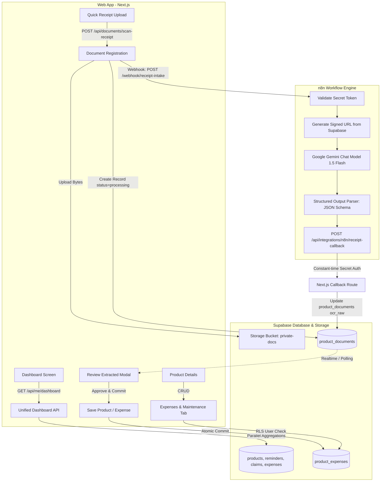
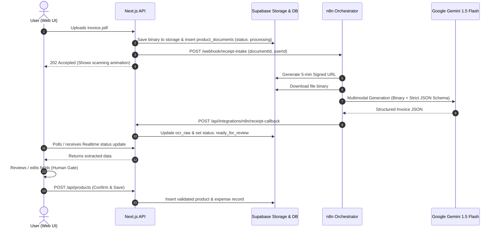

# ClaimForge / ProductVault: End-to-End Implementation Plan
## Itemtopia Gap Closures: Room Tagging, Maintenance Expenses, Unified Dashboard API, and n8n + Gemini Invoice Extraction

**Document Status:** Architecture & Implementation Specification (Zero Code Changes)  
**Target Stack:** Next.js (App Router + Server Actions / Route Handlers) + Supabase (Postgres, RLS, Storage) + n8n + Google Gemini (1.5/2.0 Flash)  
**Reference Document:** `research/itemtopia-vs-claimforge-architecture.md`  
**Governing Rules:** Strictly adheres to `AGENTS.md` (Deterministic transitions, explicit user approval gates, separated model inferences vs source facts).

---

## 1. Executive Summary & Architecture Overview

Instead of rebuilding the platform with heavy legacy microservices (NestJS + SQS + Redis + OpenSearch + Textract), ClaimForge uses a lightweight, modern composable architecture:
- **Next.js (App Router):** Auth boundary, deterministic validation, user session management, server-rendered views.
- **Supabase (PostgreSQL + RLS):** Single source of truth for assets, expenses, reminders, and document storage, protected by Row-Level Security (`auth.uid() = user_id`).
- **n8n Orchestration:** Visual event worker handling file downloads, tokenization, retries, and dispatching to Gemini.
- **Google Gemini (Flash Multimodal):** Zero-regex invoice/receipt extraction, converting raw PDF/image bytes directly into typed JSON.
- **Human Approval Gate:** AI predictions are flagged as "Model Inferences" and never auto-committed without explicit user review.



---

## 2. Feature 1: Room Tagging & Asset Lifecycle Status

### 2.1 Database Migration Specification (`supabase/migrations/20261028000000_product_room_and_status.sql`)

```sql
-- 1. Add room and status columns to public.products
alter table public.products
  add column if not exists room text not null default 'General',
  add column if not exists status text not null default 'active'
    check (status in ('active', 'in_repair', 'archived', 'disposed'));

-- 2. Create compound index for fast user room filtering
create index if not exists idx_products_user_room_status 
  on public.products(user_id, room, status);

-- 3. Document comments for schema clarity
comment on column public.products.room is 'User-assigned space or room (e.g., Kitchen, Living Room, Garage, Home Office).';
comment on column public.products.status is 'Lifecycle status of the owned asset (active, in_repair, archived, disposed).';
```

### 2.2 Backend Interface & Seams
- **File:** `apps/web/src/lib/types/product.ts`
  - Update `Product` interface:
    ```typescript
    export type ProductStatus = 'active' | 'in_repair' | 'archived' | 'disposed';
    
    export interface Product {
      // ... existing fields ...
      room: string;
      status: ProductStatus;
    }
    ```
- **API Update:** `apps/web/src/app/api/products/route.ts`
  - Accept query params: `?room=Kitchen&status=active`.
  - Validate values against allowed `ProductStatus` set.

### 2.3 UI / UX Seams
- **Products Inventory Page (`/products`):**
  - Horizontal chip filter: `All Rooms`, `Living Room`, `Kitchen`, `Bedroom`, `Office`, `Garage`, etc.
  - Status toggle: Tabs for `Active Assets` vs `Archived / Disposed`.
- **Add / Edit Product Modal:**
  - `Room` dropdown with autocomplete (allows picking standard rooms or typing a custom room name).
  - `Status` badge selector (defaulting to `active`).

---

## 3. Feature 2: Maintenance & Expense History Log

### 3.1 Database Migration Specification (`supabase/migrations/20261028010000_product_expenses.sql`)

```sql
create table if not exists public.product_expenses (
  id uuid primary key default gen_random_uuid(),
  user_id uuid not null references auth.users(id) on delete cascade,
  product_id uuid not null references public.products(id) on delete cascade,
  title text not null check (length(trim(title)) between 1 and 200),
  amount numeric(12, 2) not null check (amount >= 0),
  currency text not null default 'INR' check (length(currency) = 3),
  expense_date date not null default current_date,
  category text not null check (category in ('repair', 'maintenance', 'accessory', 'warranty_extension', 'other')),
  vendor text,
  notes text check (notes is null or length(notes) <= 2000),
  receipt_document_id uuid references public.product_documents(id) on delete set null,
  created_at timestamptz not null default now(),
  updated_at timestamptz not null default now()
);

-- Compound index for listing an asset's expenses sorted by date
create index if not exists idx_product_expenses_lookup 
  on public.product_expenses(user_id, product_id, expense_date desc);

-- Enable Row Level Security (RLS)
alter table public.product_expenses enable row level security;

-- Strict User Isolation Policy
create policy "users_manage_own_product_expenses" on public.product_expenses
  for all to authenticated
  using (auth.uid() = user_id)
  with check (auth.uid() = user_id);
```

### 3.2 Backend API Routes
1. **List & Create Expenses:** `apps/web/src/app/api/products/[id]/expenses/route.ts`
   - **`GET /api/products/[id]/expenses`**:
     - Verifies authenticated user ownership of product.
     - Returns list of expenses + aggregated metrics (`totalExpenses`, `breakdownByCategory`).
   - **`POST /api/products/[id]/expenses`**:
     - Validates payload with Zod / deterministic validator:
       - `title`: string (1-200 chars)
       - `amount`: positive number
       - `currency`: 3-char code
       - `expense_date`: ISO date string (cannot be future date)
       - `category`: enum (`repair`, `maintenance`, `accessory`, `warranty_extension`, `other`)
       - `receipt_document_id`: optional UUID
     - Inserts record scoped to `auth.uid()`.

2. **Delete / Update Expense:** `apps/web/src/app/api/products/[id]/expenses/[expenseId]/route.ts`
   - **`DELETE`**: Deletes single expense row (RLS enforces user ownership).
   - **`PATCH`**: Updates title, amount, or notes.

### 3.3 UI / UX Seams
- **Product Detail View (`/products/[id]`):**
  - Add **"Maintenance & Expenses"** tab next to "Overview" and "Documents".
  - **Expense Summary Bar:** Displays `Total Cost of Ownership (TCO)` = Purchase Price + All Recorded Maintenance Expenses.
  - **Action Button:** `+ Log Maintenance / Repair`.
  - **Expense History Table:** Columns for Date, Service/Title, Category Chip, Vendor, Amount, Receipt link (preview modal).

---

## 4. Feature 3: Unified Dashboard API (`GET /api/me/dashboard`)

### 4.1 Problem Solved
Currently, the frontend might make separate sequential calls for products, reminders, active claims, and recent activities. A single consolidated endpoint reduces round-trips to 1 fast database query batch, rendering the home dashboard instantly.

### 4.2 Endpoint Specification (`apps/web/src/app/api/me/dashboard/route.ts`)
- **Method:** `GET`
- **Auth:** Required (`auth.uid()`)
- **Cache-Control:** `private, no-cache, no-store, must-revalidate`

#### Consolidated Response JSON Contract:
```json
{
  "summary": {
    "totalProducts": 14,
    "activeWarranties": 9,
    "expiringSoonCount": 2,
    "upcomingRemindersCount": 3,
    "totalAssetValue": 248500.00,
    "totalMaintenanceSpend": 18200.00,
    "currency": "INR"
  },
  "rooms": [
    { "name": "Living Room", "count": 6 },
    { "name": "Kitchen", "count": 4 },
    { "name": "Home Office", "count": 3 },
    { "name": "General", "count": 1 }
  ],
  "actionItems": [
    {
      "id": "rem-101",
      "type": "amc_renewal",
      "severity": "high",
      "title": "Daikin AC AMC Due",
      "description": "Annual service due before summer warranty validation",
      "dueDate": "2026-11-04",
      "dueInDays": 7,
      "productId": "prod-1",
      "productName": "Daikin 1.5 Ton 5-Star Inverter AC"
    },
    {
      "id": "rem-102",
      "type": "warranty_expiration",
      "severity": "medium",
      "title": "Sony WH-1000XM5 Warranty Expiring",
      "description": "Standard 1-year manufacturer warranty ends in 18 days",
      "dueDate": "2026-11-15",
      "dueInDays": 18,
      "productId": "prod-2",
      "productName": "Sony WH-1000XM5 Headphones"
    }
  ],
  "upcomingTimeline": [
    { "date": "2026-11-04", "title": "Daikin AC AMC Due", "type": "amc" },
    { "date": "2026-11-15", "title": "Sony Headphones Warranty Ends", "type": "warranty" },
    { "date": "2026-11-28", "title": "Water Purifier Filter Replacement", "type": "replenishment" }
  ],
  "recentProducts": [
    {
      "id": "prod-1",
      "name": "Daikin 1.5 Ton AC",
      "brand": "Daikin",
      "room": "Living Room",
      "status": "active",
      "purchaseDate": "2024-05-10",
      "warrantyValidUntil": "2029-05-10",
      "imageUrl": "https://..."
    }
  ]
}
```

### 4.3 Database Query Strategy (High Performance Single RPC)
Rather than executing 6 separate round trips from Node.js, create a single Postgres stored procedure or parallel Promise query:
```sql
create or replace function public.get_user_dashboard_metrics(p_user_id uuid)
returns json language plpgsql security definer as $$
declare
  v_result json;
begin
  select json_build_object(
    'summary', (
      select json_build_object(
        'totalProducts', count(*),
        'activeWarranties', count(*) filter (where warranty_valid_until >= current_date),
        'expiringSoonCount', count(*) filter (where warranty_valid_until between current_date and current_date + interval '30 days'),
        'totalAssetValue', coalesce(sum(purchase_price), 0),
        'currency', 'INR'
      ) from public.products where user_id = p_user_id and status = 'active'
    ),
    'rooms', (
      select coalesce(json_agg(r), '[]'::json)
      from (
        select room as name, count(*)::int as count 
        from public.products 
        where user_id = p_user_id and status = 'active'
        group by room 
        order by count desc
      ) r
    )
  ) into v_result;
  return v_result;
end;
$$;
```

---

## 5. Feature 4: Automated Invoice Extraction via n8n + Gemini

### 5.1 Architecture & Separation of Concerns
1. **User Action:** User drags an invoice (PDF, PNG, JPG) into the "Quick Add / Scan Invoice" dropzone.
2. **Next.js Server:**
   - Uploads file securely to private Supabase storage bucket (`private-docs/user_id/...`).
   - Inserts record into `product_documents` with `ingestion_status = 'processing'`.
   - Dispatches a webhook request to n8n with:
     - `documentId`
     - `userId`
     - `fileKey`
     - `traceId`
3. **n8n Workflow Execution:**
   - Validates HMAC / Bearer secret (`X-ClaimForge-Webhook-Secret`).
   - Calls Supabase API using Service Role to create a temporary signed download URL (valid for 5 minutes).
   - Downloads document binary.
   - Forwards binary to **Google Gemini 1.5 Flash** with system instructions and a strict JSON Output Schema.
   - Extracts structured facts: Merchant, Date, Item Name, Model, Serial, Tax, Total, Warranty hints.
   - Calls Next.js Callback Endpoint: `POST /api/integrations/n8n/receipt-callback`.
4. **Next.js Callback Route:**
   - Verifies constant-time secret `x-claimforge-callback-secret`.
   - Updates `product_documents.ocr_raw` with the structured extraction.
   - Sets `ingestion_status = 'ready_for_review'`.
5. **Human Approval Gate (Frontend UI):**
   - User receives modal: **"Review Extracted Invoice Data"**.
   - Fields show Gemini’s inferences with visual tags (`[AI Inferred]`).
   - User reviews or adjusts Price, Purchase Date, Product Name, Room assignment.
   - User clicks **"Confirm & Create Asset"** (or **"Log as Expense"**).
   - Deterministic Next.js mutation commits the verified record to `products` and/or `product_expenses`.



### 5.2 Detailed n8n Node Configuration
1. **Webhook Node:**
   - Path: `/webhook/receipt-intake`
   - Method: `POST`
   - Authentication: Header Auth (`X-ClaimForge-Webhook-Secret`)
2. **Supabase Node (Get Signed URL):**
   - Resource: Storage
   - Operation: Create Signed URL (expiry: 300 seconds)
3. **HTTP Request Node (Fetch Binary):**
   - URL: `{{ $json.signedUrl }}`
   - Response Format: File / Binary (`data`)
4. **Google Gemini Chat Model Node (Advanced AI):**
   - Model: `gemini-1.5-flash`
   - Temperature: `0.0`
   - System Message:
     > *"You are an expert financial document and invoice auditor for ClaimForge. Analyze the attached invoice or receipt image/PDF. Extract exact merchant details, transaction dates, line items, prices, and any explicit warranty duration or coverage clauses. Distinguish strictly between explicit text facts and inferences."*
5. **Structured Output Parser Node (JSON Schema):**
   ```json
   {
     "type": "object",
     "properties": {
       "merchant": {
         "type": "object",
         "properties": {
           "name": { "type": "string" },
           "taxId": { "type": ["string", "null"] },
           "address": { "type": ["string", "null"] }
         },
         "required": ["name"]
       },
       "invoice": {
         "type": "object",
         "properties": {
           "invoiceNumber": { "type": ["string", "null"] },
           "invoiceDate": { "type": "string", "description": "YYYY-MM-DD format" },
           "currency": { "type": "string", "default": "INR" },
           "subtotal": { "type": ["number", "null"] },
           "taxAmount": { "type": ["number", "null"] },
           "totalAmount": { "type": "number" },
           "paymentMethod": { "type": ["string", "null"] }
         },
         "required": ["invoiceDate", "totalAmount", "currency"]
       },
       "items": {
         "type": "array",
         "items": {
           "type": "object",
           "properties": {
             "name": { "type": "string" },
             "brand": { "type": ["string", "null"] },
             "model": { "type": ["string", "null"] },
             "serialNumber": { "type": ["string", "null"] },
             "category": { "type": "string" },
             "price": { "type": "number" },
             "warrantyPeriodMonths": { "type": ["integer", "null"] }
           },
           "required": ["name", "price"]
         }
       },
       "suggestedAction": {
         "type": "string",
         "enum": ["create_product", "log_maintenance_expense", "multiple_products"]
       },
       "confidence": {
         "type": "number",
         "description": "Overall extraction confidence between 0.0 and 1.0"
       }
     },
     "required": ["merchant", "invoice", "items", "confidence", "suggestedAction"]
   }
   ```
6. **HTTP Request Node (Callback to Next.js):**
   - URL: `https://your-domain.com/api/integrations/n8n/receipt-callback`
   - Method: `POST`
   - Headers:
     - `Content-Type: application/json`
     - `x-claimforge-callback-secret: {{ $env.N8N_CALLBACK_SECRET }}`
   - Body:
     ```json
     {
       "documentId": "={{ $('Webhook').item.json.body.documentId }}",
       "userId": "={{ $('Webhook').item.json.body.userId }}",
       "status": "ready_for_review",
       "extractedData": "={{ $json }}"
     }
     ```

### 5.3 Next.js Callback Route Specification (`apps/web/src/app/api/integrations/n8n/receipt-callback/route.ts`)
- Timing-safe secret verification (`constantTimeMatches(N8N_CALLBACK_SECRET, request.headers.get("x-claimforge-callback-secret"))`).
- Validates payload structure using Zod.
- Updates `public.product_documents`:
  ```sql
  update public.product_documents
  set 
    ocr_raw = p_extracted_data,
    ingestion_status = 'ready_for_review',
    updated_at = now()
  where id = p_document_id and user_id = p_user_id;
  ```

---

## 6. End-to-End Implementation Roadmap & TDD Seams

Following the pairing philosophy in `AGENTS.md` and TDD practices, development should proceed in 5 vertical test-first stages:

### Stage 1: Database Migrations & Types (Supabase)
1. **Migration 1:** Add `room` and `status` to `products` + compound indexes.
2. **Migration 2:** Create `product_expenses` table with RLS and cascade rules.
3. **Migration 3:** Add `get_user_dashboard_metrics` Postgres function.
4. **Verification Seam:** Run Supabase local tests or CLI validation to ensure RLS strictly blocks cross-user read/write.

### Stage 2: Unified Dashboard API (`GET /api/me/dashboard`)
1. **Red Test:** Create `apps/web/src/app/api/me/dashboard/route.test.ts`. Verify 401 when unauthorized, and correct consolidated JSON structure when authenticated.
2. **Green Implementation:** Implement `route.ts` using Supabase client to aggregate product counts, warranties, rooms, and action items.
3. **Refactor:** Optimize with single database call.

### Stage 3: Maintenance Expenses API & UI
1. **Red Test:** Create `apps/web/src/app/api/products/[id]/expenses/route.test.ts`. Test validation on negative amounts, invalid dates, and foreign keys.
2. **Green Implementation:** Implement GET and POST handlers with strict user checks.
3. **Frontend Component:** Build `<ProductExpensesTab />` with summary cards (Total Maintenance Spent) and `<AddExpenseModal />`.

### Stage 4: n8n + Gemini Receipt Webhook & Callback
1. **Red Test:** Test callback route with timing-safe auth rejection and valid payload ingestion.
2. **Green Implementation:** Implement `apps/web/src/app/api/integrations/n8n/receipt-callback/route.ts`.
3. **n8n Workflow Setup:** Import template into n8n, configure Gemini Chat Model credentials and JSON Output Parser.

### Stage 5: "Scan Receipt" Review Modal (The Explicit Approval Gate)
1. **Frontend Component:** `<InvoiceReviewModal />`.
2. **Human Approval Seam:** Shows extracted merchant, date, items, and suggested category. User can edit any field.
3. **Commit Action:** Clicking "Save to Inventory" calls `POST /api/products` and links the source receipt.

---

## 7. Security, Privacy & Safety Checklist

- [x] **No Automated Legal Claims:** Invoices are parsed for record-keeping and inventory only; warranty disputes remain under manual, recorded user approval.
- [x] **Private Document Storage:** Receipts are stored in Supabase private buckets with short-lived signed URLs (5 minutes max).
- [x] **Constant-time Secret Verification:** Webhooks and callback routes use `crypto.timingSafeEqual` to prevent timing attacks.
- [x] **Model Inferences Labeled:** All extracted fields are presented with visual AI tags until user confirmation.
- [x] **Strict RLS:** `product_expenses` and `products` have independent RLS policies verifying `auth.uid() = user_id`.

---

**Summary:** This plan provides an immediate, production-grade roadmap to build Room Tagging, Maintenance Expenses, Unified Dashboard metrics, and Automated Gemini Invoicing directly within ClaimForge's current Next.js + Supabase + n8n architecture without rewriting the stack or introducing heavyweight legacy microservices.
